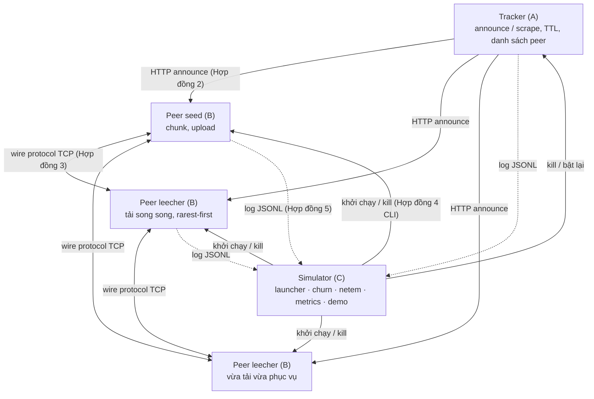

# DS02 – Hệ thống chia sẻ file P2P mô phỏng BitTorrent (Python)

Đồ án môn **Hệ thống phân tán** – đề tài DS02. Một file được chia thành các chunk có mã SHA-1; **tracker** giúp các peer tìm nhau;
các **peer** vừa tải vừa phục vụ chunk cho nhau (tải song song từ nhiều nguồn); bộ **mô phỏng** bật hàng chục tiến trình, gây
churn (peer vào/ra/sập), làm sập tracker, đo đạc và vẽ biểu đồ.

> A P2P file-sharing system in the style of BitTorrent, written in Python, plus a churn simulator, an automated test suite,
> an experiment pipeline and a live terminal demo. Quick start: `pip install -r requirements.txt` then `py demo/run_demo.py`.

---

## 1. Kiến trúc



Năm hợp đồng giao tiếp (chi tiết trong `docs/`):

| # | Hợp đồng | Người viết | Tài liệu |
| --- | --- | --- | --- |
| 1 | Metainfo `*.torrent.json` (`info.name/length/piece_length/pieces`, `info_hash`, `announce`) | B | `docs/contracts/metainfo-and-peer-cli.md` |
| 2 | API tracker `announce(info_hash, peer_id, ip, port, event, left)` → `{interval, peers[]}`, `scrape` | A | `docs/protocol.md` (A7) |
| 3 | Wire protocol: `handshake, bitfield, have, interested, choke/unchoke, request, piece, keepalive` (4 byte độ dài + 1 byte loại) | A | `docs/protocol.md` (A7) |
| 4 | CLI peer `--torrent --port --dir --role seed/leech --max-up-kbps`, mã thoát | B | `docs/contracts/metainfo-and-peer-cli.md` |
| 5 | Log sự kiện JSON Lines + định dạng kịch bản YAML | C | `docs/log-and-scenario-spec.md` |

## 2. Phân công

| Thành viên | Module | Đầu việc | Thư mục |
| --- | --- | --- | --- |
| **A** – Tracker & tầng mạng | tracker, wire protocol, kết nối, client tracker | A1–A7 | `src/tracker/`, `src/protocol/`, `src/network/`, `src/trackerclient/` |
| **B** – Peer core | metainfo, lưu trữ chunk, chọn chunk, tải song song, upload, tiến trình `peer` | B1–B7 | `src/torrent/`, `src/storage/`, `src/peer/` |
| **C** – Mô phỏng & đánh giá | launcher, churn, netem, metrics, kiểm thử E2E, thí nghiệm, demo | C1–C7 | `src/sim/`, `scenarios/`, `tests/`, `results/`, `demo/` |

Chi tiết: `docs/work-division.md`.

## 3. Cài đặt

Yêu cầu Python ≥ 3.10 (đã thử trên Windows với `py` 3.14 và Linux với 3.13).

```bash
py -m pip install -r requirements.txt      # Windows   (Linux/macOS: python3 -m pip install -r requirements.txt)
```

Mọi lệnh dưới đây chạy từ thư mục gốc của repo. Trên Linux/macOS thay `py` bằng `python3`.

## 4. Phần của C – chạy mô phỏng, kiểm thử, thí nghiệm, demo

### 4.1 Chạy một kịch bản (C1 + C2 + C3)

```bash
py src/sim/launcher.py --scenario scenarios/baseline.yaml            # in mọi sự kiện ra màn hình
py src/sim/launcher.py --scenario scenarios/high_churn.yaml --quiet  # chỉ in tóm tắt
```

Launcher sinh file dữ liệu tất định + metainfo (Hợp đồng 1, có SHA-1 thật), bật tracker, bật seed/leecher, chạy lịch churn,
fault injection (tracker crash, kill peer, peer gửi chunk hỏng), gom log về `logs/<kịch bản>/events.jsonl` và ghi mã thoát của mọi tiến trình vào
`logs/<kịch bản>/processes.json`. Thư mục dữ liệu của các peer nằm trong thư mục tạm của hệ điều hành (`%TEMP%\ds02-sim`) để tránh khóa file
của OneDrive; thêm `--keep-dirs` để giữ lại.

| Kịch bản | Nội dung |
| --- | --- |
| `baseline.yaml` | 1 seed, 3 leecher, mạng ổn định |
| `multi_seed.yaml` | 4 seed, 3 leecher – tải song song |
| `high_churn.yaml` | Poisson (λ=0.7/s) + thời gian sống Pareto + 50% crash |
| `flash_crowd.yaml` | 8 leecher ập vào trong 0.5 s, rời đồng loạt |
| `tracker_crash.yaml` | tracker bị kill ở giây 3, bật lại ở giây 8; 2 leecher đến lúc tracker đang sập |
| `demo_live.yaml` | kịch bản trình diễn 7 tình huống bắt buộc |

Xem trước lịch churn (tất định theo `random_seed`): `py src/sim/churn.py --scenario scenarios/high_churn.yaml`.

### 4.2 Xuất số liệu (C4)

```bash
py src/sim/metrics.py --scenario baseline      # đọc logs/baseline/events.jsonl → results/baseline_*.csv
```

CSV chứa đủ 5 nhóm số liệu: thời gian tải từng peer (`download_time_sec`), thông lượng theo thời gian (`download_kbps`, `upload_kbps`, KiB/s),
hệ số nhân bản chunk (`avg_chunk_replication`, `chunk_<i>_replicas`), tỉ lệ hoàn tất (`completion_ratio_pct`) và tải tracker
(`tracker_announces`, `tracker_announces_failed` mỗi giây, tổng trong `_summary.csv`).

### 4.3 Kiểm thử toàn hệ thống (C5) – một lệnh

```bash
py tests/e2e/run_all.py           # 15 hạng mục (59 unit test + 12 kiểm thử E2E), ~2–3 phút, in bảng PASS/FAIL
py tests/e2e/run_all.py --quick   # bỏ 5 kịch bản dài, ~40 s
py -m pytest -q                   # chỉ các unit test (Role B + Role C)
```

Bao phủ mục 9 của đề: **Functional** (hợp đồng CLI/mã thoát, so SHA-256 + SHA-1 từng chunk với file gốc), **Concurrency** (high churn, flash crowd),
**Fault & Recovery** (kill nguồn → `peer_lost` → `switch_source`, graceful vs crash, tracker crash + respawn),
**Security/invalid data** (chunk sai hash bị từ chối, peer xấu bị cấm), **Performance** (giới hạn băng thông đúng mức cấu hình, multi-seed nhanh hơn baseline).

### 4.4 Thí nghiệm & biểu đồ (C6)

```bash
py src/sim/run_experiments.py                           # 5 kịch bản → CSV + 6 biểu đồ + báo cáo (~2 phút)
py src/sim/run_experiments.py --only baseline multi_seed
py src/sim/report.py                                    # chỉ vẽ lại biểu đồ/báo cáo từ CSV có sẵn
```

Kết quả: `results/summary_metrics.csv`, `results/charts/exp1…exp6*.png`, và **`results/analysis.md`** (báo cáo tiếng Việt có số liệu cụ thể và kết luận
cho từng kịch bản – dùng trực tiếp cho chương "Thí nghiệm và đánh giá").

### 4.5 Demo trực tiếp (C7) – một lệnh

```bash
py demo/run_demo.py
```

Dashboard trên terminal hiển thị số peer đang hoạt động, vai trò, trạng thái kết nối, bitfield `[####....] 4/16 (25%)`, số chunk đã upload,
sự kiện gần nhất và **danh sách 7 tình huống bắt buộc (mục 6.4)** – mỗi mục chỉ được đánh dấu khi sự kiện thật xảy ra:
tạo metadata & chia sẻ, tải song song từ ≥ 2 peer, leecher upload trước khi tải xong, dừng một nguồn giữa chừng, tự chuyển nguồn,
phát hiện & từ chối chunk sai hash, ghép file & xác minh hash. Demo kết thúc sau ~30 s với `RESULT: 7/7` (mã thoát 0).
Tùy chọn: `--no-clear` (in theo khối, dùng khi quay màn hình/CI), `--no-color`.

## 5. Hướng dẫn tích hợp cho A và B

Mọi công cụ của C nhận **entrypoint** là đường dẫn script (`src/sim/stub_peer.py`) hoặc module (`"-m peer"`). Khi chạy, `src/` và thư mục gốc
được thêm vào `PYTHONPATH` của tiến trình con, nên `-m peer`, `-m tracker`, `-m torrent.make_torrent` chạy được ngay. **Không cần sửa mã của C.**

### 5.1 B – thay StubPeer bằng peer thật

Peer của B phải đáp ứng đúng Hợp đồng 4 (launcher gọi):

```
py -m peer --torrent <path> --port <int> --dir <path> --role seed|leech --peer-id <seed|leech-PORT> --max-up-kbps <int> [--exit-on-complete]
```

- seed đọc file `DIR/<info.name>` (launcher đã chép file gốc vào); leech ghi file hoàn chỉnh vào `DIR/<info.name>`;
- in log Hợp đồng 5 ra stdout (`docs/log-and-scenario-spec.md`, mục 1.6 có hàm mẫu 3 dòng);
- bắt `SIGINT`, `SIGTERM` **và `SIGBREAK` (Windows)** để announce `stopped`, log `stopped` rồi thoát;
- mã thoát `0/1/2/3/130` như hợp đồng.

```bash
py src/sim/launcher.py --scenario scenarios/baseline.yaml --peer-script "-m peer"
py src/sim/launcher.py --scenario scenarios/baseline.yaml --peer-script "-m peer" --make-torrent-script "-m torrent.make_torrent"
py tests/e2e/run_all.py --peer-script "-m peer"
py src/sim/run_experiments.py --peer-script "-m peer"
py demo/run_demo.py --peer-script "-m peer"
```

Các cờ chỉ dành cho StubPeer (`--latency-ms`, `--corrupt-pieces`) **không** được truyền cho peer thật (tự nhận diện; ép bằng `--sim-flags on|off`).
Vì vậy với peer thật, các kiểm thử dựa vào chunk hỏng sẽ chỉ đạt khi B có cơ chế tương đương; độ trễ chỉ được mô phỏng với StubPeer.

### 5.2 A – dùng tracker thật (`src/tracker`, đã có trên `main`)

Tracker của A chạy bằng `py -m src.tracker --host H --port N --interval S --ttl S`. Mặc định `interval=30`, quá dài cho kịch bản
vài chục giây, nên luôn truyền `--tracker-args "--interval 2 --ttl 6"`:

```bash
py src/sim/launcher.py --scenario scenarios/tracker_crash.yaml --tracker-script "-m src.tracker" --tracker-args "--interval 2 --ttl 6"
py src/sim/run_experiments.py --tracker-script "-m src.tracker" --tracker-args "--interval 2 --ttl 6"
py tests/e2e/run_all.py --tracker-script "-m src.tracker" --tracker-args "--interval 2 --ttl 6"
py src/sim/launcher.py --scenario scenarios/baseline.yaml --no-tracker     # tracker đã chạy sẵn ở tracker.host:port
```

Đã kiểm tra với tracker của A: `baseline` và `tracker_crash` đạt 100%, tracker bị kill thật rồi bật lại, swarm đăng ký lại sau ~0.01 s.
Tracker của A ghi `tracker_started` / `tracker_stopped`; launcher tự đổi thành `started` / `stopped` (Hợp đồng 5, giữ tên gốc trong
`meta.original_event`) và chấp nhận thêm `http_request`, `peers_expired`.

Kịch bản `tracker_crash` sẽ **kill thật** tiến trình tracker của A rồi bật lại – đây là phép thử của A3 (swarm tự dựng lại từ announce).

### 5.3 Cả hai cùng lúc

```bash
py tests/e2e/run_all.py --peer-script "-m peer" --tracker-script "-m src.tracker" --tracker-args "--interval 2 --ttl 6"
py src/sim/run_experiments.py --peer-script "-m peer" --tracker-script "-m src.tracker" --tracker-args "--interval 2 --ttl 6" --make-torrent-script "-m torrent.make_torrent"
```

## 6. Cấu trúc thư mục

```
demo/run_demo.py              C7 – demo một lệnh + dashboard
docs/                         hợp đồng giao tiếp, phân công
scenarios/*.yaml              C1/C6 – kịch bản
src/sim/launcher.py           C1 – orchestrator
src/sim/churn.py              C2 – Poisson / Exponential / Pareto / flash crowd / mass departure
src/sim/netem.py              C3 – băng thông, độ trễ, tracker crash, kill / corrupt peer
src/sim/metrics.py            C4 – log JSONL → CSV
src/sim/run_experiments.py    C6 – chạy 5 thí nghiệm; report.py vẽ biểu đồ + analysis.md
src/sim/stub_peer.py          StubPeer – peer BitTorrent tối giản nhưng thật (TCP, SHA-1, rarest-first, choke, throttle)
src/sim/stub_tracker.py       StubTracker – tracker HTTP tối giản (announce, scrape, TTL)
src/sim/common.py, procutil.py  schema log, dữ liệu tất định, metainfo, quản lý tiến trình đa nền tảng
src/torrent/, src/storage/    B1, B2 (Role B)
tests/test_sim_modules.py     unit test của C;  tests/test_metainfo.py, test_storage.py của B
tests/e2e/run_all.py          C5 – bộ kiểm thử một lệnh
results/                      CSV, biểu đồ, analysis.md
logs/                         log của từng lần chạy (không commit)
```

## 7. Ghi chú Windows

- Dùng `py` (Python launcher). Mọi file/stdout đều mở UTF-8; tiến trình con chạy với `PYTHONUTF8=1`.
- Dừng đàng hoàng dùng `CTRL_BREAK_EVENT` + file `.sim_stop`; nếu tiến trình không thoát sau 4 s thì bị kill – không còn tiến trình mồ côi.
- Nếu cổng 8000 bận, launcher tự chọn cổng trống cho tracker; nếu cổng peer (9001…) bận, launcher báo lỗi rõ ràng.
- Windows Firewall có thể hỏi quyền cho Python lần đầu – chỉ cần cho phép mạng riêng (mọi kết nối là `127.0.0.1`).
