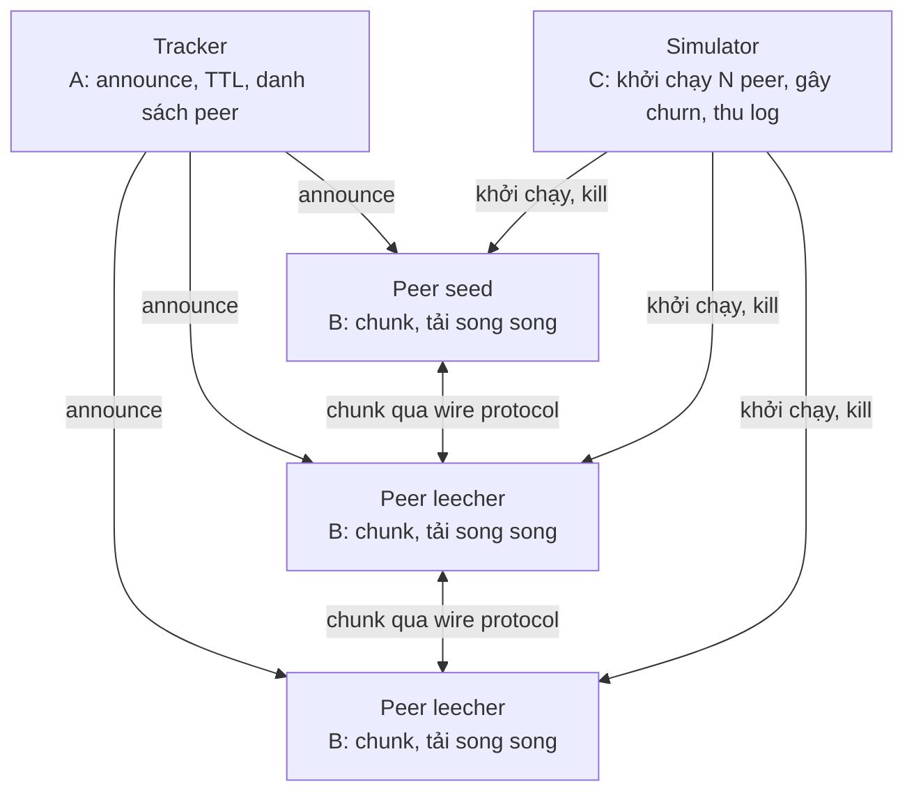

# DS02 – Phân chia công việc cho 3 thành viên

## 1. Tổng quan và nguyên tắc chia việc

**DS02 – P2P file-sharing mô phỏng BitTorrent** được chia thành 3 module có chủ sở hữu riêng: **A – Tracker & tầng mạng**, **B – Peer core**, **C – Mô phỏng churn & đánh giá**. Mỗi người sở hữu một phần mã nguồn riêng, chỉ gặp nhau ở các hợp đồng giao tiếp (mục 2) được cả nhóm chốt chung từ đầu.

Ba nguyên tắc để không ai phải chờ ai:

- **Hợp đồng trước, mã sau.** Định dạng metainfo, API tracker, thông điệp peer-to-peer, CLI của peer và định dạng log được viết ra và cả nhóm ký duyệt trước khi code.
- **Mỗi người tự có bản giả (mock) của phần còn lại.** A có peer giả để thử tracker, B có transport trong bộ nhớ để thử tải file, C có peer "stub" để thử churn. Khi các module thật xong thì chỉ cần thay mock bằng thật.
- **Chia theo khái niệm hệ phân tán, không chia theo lớp kỹ thuật.** Mỗi người đều chạm vào ít nhất một khái niệm chính của đề, nên ai cũng có phần để giải thích khi báo cáo.

| Khái niệm của đề | Người chịu trách nhiệm chính | Người hỗ trợ |
| --- | --- | --- |
| P2P (peer vừa tải vừa phục vụ) | B | A (kết nối) |
| Tracker | A | C (đo tải tracker) |
| Chia chunk và nhân bản (replication) | B | C (đo độ sẵn có của chunk) |
| Tải song song | B | A (nhiều kết nối cùng lúc) |
| Churn (peer vào/ra/sập) | C | A (phát hiện peer chết), B (phục hồi khi mất nguồn) |

## 2. Kiến trúc và hợp đồng giao tiếp

A sở hữu tracker và đường truyền, B sở hữu peer, C điều khiển và quan sát từ bên ngoài. Năm hợp đồng dưới đây là chỗ duy nhất ba người phải thống nhất với nhau trước khi code.

| Hợp đồng | Nội dung cần chốt | Người viết | Người dùng |
| --- | --- | --- | --- |
| 1. Metainfo | JSON gồm tên file, kích thước, `piece_length`, mảng hash SHA-1 từng chunk, `info_hash`, địa chỉ tracker | B | A, C |
| 2. API tracker | `announce(info_hash, peer_id, ip, port, event, left)` trả về `{interval, peers[]}`; `scrape`; các `event` gồm `started`, `completed`, `stopped` | A | B, C |
| 3. Thông điệp giữa peer | `handshake`, `bitfield`, `have`, `interested`, `choke` / `unchoke`, `request(index, begin, length)`, `piece`, `keepalive`; khung gồm 4 byte độ dài + 1 byte loại | A | B |
| 4. CLI và vai trò của peer | `--torrent --port --dir --role seed/leech --max-up-kbps`; mã thoát khi tải xong | B | C |
| 5. Log sự kiện | Mỗi dòng một JSON gồm `ts`, `peer_id`, `event` (ví dụ `piece_done`, `peer_lost`, `completed`) và chỉ số chunk | C | A, B |

## 3. Thành viên A – Tracker và tầng mạng

A sở hữu mọi thứ nằm giữa các máy: máy chủ tracker, giao thức dây (wire protocol) và việc mở/đóng kết nối. A **không phụ thuộc** vào B hay C để bắt đầu: tracker chạy độc lập và kiểm thử bằng script gọi API.

| # | Công việc | Sản phẩm bàn giao | Xong khi |
| --- | --- | --- | --- |
| A1 | Máy chủ tracker: API `announce` và `scrape`, sổ đăng ký swarm theo `info_hash`, trả danh sách peer ngẫu nhiên (bỏ chính người gọi) | `tracker/` chạy được bằng một lệnh | Script giả 100 peer announce và nhận danh sách đúng |
| A2 | Phát hiện peer chết: announce định kỳ, hết hạn (TTL) thì xóa peer, xử lý sự kiện `started` / `completed` / `stopped` | Logic TTL + bảng trạng thái peer | Peer ngừng announce biến mất khỏi danh sách sau đúng TTL |
| A3 | Tracker an toàn khi nhiều yêu cầu đồng thời và phục hồi sau khi khởi động lại (peer announce lại là swarm dựng lại) | Khóa / hàng đợi + test khởi động lại | Kill tracker rồi bật lại, swarm tự hồi |
| A4 | Wire protocol: khung thông điệp, `handshake`, mã hóa / giải mã mọi loại thông điệp ở mục 2 | Thư viện `protocol/` + unit test | Round-trip mọi thông điệp, từ chối dữ liệu hỏng |
| A5 | Quản lý kết nối: nghe / kết nối TCP, timeout, keepalive, giới hạn số kết nối, phát hiện đứt kết nối và báo lại cho peer core qua interface `Transport` | `network/` + `Transport` thật | Hai tiến trình trao đổi thông điệp; ngắt dây thì bên kia nhận sự kiện `disconnected` |
| A6 | Thư viện client tracker cho peer: announce định kỳ, thử lại với backoff khi tracker không phản hồi | `trackerclient/` | Peer sống sót khi tracker tắt vài chu kỳ |
| A7 | Tài liệu giao thức và kiểm thử tải tracker (số yêu cầu / giây, độ trễ) | `docs/protocol.md` + kết quả đo | Số liệu gửi sang C để đưa vào báo cáo |

**Giao cho người khác:** A cung cấp interface `Transport` (A5) và `trackerclient` (A6) cho B. Trong lúc chờ, B dùng transport trong bộ nhớ tự viết, nên A chậm cũng không chặn B.

## 4. Thành viên B – Peer core

B sở hữu toàn bộ logic bên trong một peer: cắt file thành chunk, chọn chunk nào tải trước, tải song song từ nhiều peer và phục vụ chunk cho người khác. B viết và kiểm thử trên `FakeTransport` (kết nối trong bộ nhớ) và tracker giả, nên **không phải chờ A**.

| # | Công việc | Sản phẩm bàn giao | Xong khi |
| --- | --- | --- | --- |
| B1 | Metainfo: tạo file mô tả (tên, kích thước, `piece_length`, mảng hash SHA-1 từng chunk, `info_hash`, địa chỉ tracker) | `torrent/` + công cụ `make-torrent` | File bất kỳ sinh ra metainfo và đọc lại đúng |
| B2 | Chunking và lưu trữ: cắt file, ghi / đọc chunk theo chỉ số, xác minh hash, phục dựng file đầy đủ, quản lý `bitfield` | `storage/` | Chunk sai hash bị từ chối; ghép lại khớp file gốc |
| B3 | Chọn chunk: chiến lược rarest-first dựa trên `bitfield` / `have` của các peer, chế độ endgame khi gần xong | `piece_picker` + unit test | Chunk hiếm được tải trước trong test có kịch bản dựng sẵn |
| B4 | Tải song song: giữ nhiều `request` đang bay đồng thời tới nhiều peer, pipeline, giới hạn số yêu cầu mỗi peer | `downloader/` | Tải từ 5 seed nhanh hơn tải từ 1 seed (đo trên mạng giả) |
| B5 | Phục vụ chunk (upload): trả `piece` cho yêu cầu, `choke` / `unchoke` đơn giản, giới hạn băng thông tải lên | `uploader/` | Leecher trở thành nguồn cho leecher khác ngay khi có chunk |
| B6 | Nhân bản và chịu lỗi phía peer: khi một peer đang tải thì chết, gửi lại yêu cầu sang peer khác; hỏi tracker lấy thêm peer khi sắp hết nguồn | Logic retry + tái kết nối | Ngắt 1 nguồn giữa chừng, peer vẫn tải xong và file đúng hash |
| B7 | Tiến trình `peer` hoàn chỉnh: CLI (`--torrent --port --dir --role seed/leech --max-up-kbps`), ghi log sự kiện JSON theo mục 2 | `peer` chạy được bằng một lệnh | C khởi động được peer chỉ bằng CLI này |

**Giao cho người khác:** B cung cấp CLI `peer` (B7) và log sự kiện cho C. B chỉ cần interface `Transport` và `trackerclient` từ A; cả hai đều có bản giả do B tự viết trong lúc chờ.

## 5. Thành viên C – Mô phỏng churn và đánh giá

C sở hữu cách hệ thống được chạy, bị phá và được đo: khởi động nhiều peer, cho peer vào / ra / sập ngẫu nhiên (churn), thu số liệu và viết kết quả thí nghiệm. C bắt đầu với `StubPeer` (tiến trình giả đúng CLI và định dạng log ở mục 2), nên **không phải chờ A hay B**. Khi `peer` thật (B7) sẵn sàng thì đổi lệnh khởi động, phần còn lại giữ nguyên.

| # | Công việc | Sản phẩm bàn giao | Xong khi |
| --- | --- | --- | --- |
| C1 | Bộ khởi chạy (orchestrator): đọc file kịch bản (số seed, số leecher, kích thước file, `piece_length`, băng thông), bật tracker và N peer, dọn dẹp khi xong | `sim/launcher` + `scenarios/*.yaml` | Một lệnh chạy trọn một kịch bản với `StubPeer` |
| C2 | Engine churn: peer vào theo phân phối Poisson, thời gian sống theo phân phối mũ hoặc Pareto; rời đàng hoàng (gửi `stopped`) khác với sập (kill tiến trình); kịch bản flash crowd và rời đồng loạt | `sim/churn` có seed ngẫu nhiên để lặp lại được | Cùng seed cho ra cùng dãy sự kiện vào / ra |
| C3 | Giả lập mạng: giới hạn băng thông từng peer, thêm độ trễ; tắt và bật lại tracker để thử chịu lỗi | `sim/netem` | Peer chậm hơn đúng mức cấu hình |
| C4 | Thu số liệu từ log JSON: thời gian tải xong, thông lượng, hệ số nhân bản của từng chunk theo thời gian, tỉ lệ hoàn tất, tải tracker | `sim/metrics` xuất CSV | Sinh CSV từ log của một lần chạy |
| C5 | Kiểm thử toàn hệ thống: so hash file tải về với file gốc, test hồi quy cho từng kịch bản, script chạy tất cả | `tests/e2e` | Mọi kịch bản pass; log rõ khi fail |
| C6 | Thí nghiệm và biểu đồ: baseline, thêm seed, churn cao, flash crowd, tracker sập; vẽ biểu đồ và phân tích | `results/` + biểu đồ | Mỗi kịch bản có biểu đồ và một đoạn kết luận |
| C7 | Demo: kịch bản trình diễn ngắn, màn hình theo dõi số peer, chunk đã có và tiến độ tải theo thời gian thực | `demo/` | Chạy demo chỉ bằng một lệnh |

**Nhận từ người khác:** CLI `peer` và log từ B, API tracker từ A. C không sửa mã của hai người kia; lỗi phát hiện được thì mở issue gửi cho đúng chủ module.

## 6. Công việc chung, chia đều cho cả ba

Phần không thuộc module nào được chia theo cùng một quy tắc: mỗi người lo phần liên quan tới module của mình. Review chéo chia vòng tròn để ai cũng đọc code của người khác.

| Hạng mục | A | B | C |
| --- | --- | --- | --- |
| Chốt hợp đồng giao tiếp | Viết API tracker và thông điệp dây | Viết định dạng metainfo và CLI peer | Viết định dạng log và file kịch bản |
| Báo cáo: chương chuyên sâu | Tracker, giao thức, phát hiện peer chết | Chunking, nhân bản, tải song song | Churn, thí nghiệm, đánh giá |
| Báo cáo: phần chung | Giới thiệu, tương quan kiến trúc | Thiết kế tổng thể, hạn chế | Kết luận, hướng phát triển |
| README và hướng dẫn chạy | Chạy tracker | Chạy peer, tạo torrent | Chạy mô phỏng, đọc kết quả |
| Slide và thuyết trình | Trình bày phần của A | Trình bày phần của B | Trình bày phần của C và demo |
| Review code chéo | Review code của B | Review code của C | Review code của A |
| Tích hợp | Sửa lỗi giao thức và kết nối | Sửa lỗi logic tải | Sửa lỗi kịch bản và đo đạc |

## 7. Cách làm song song bằng bản giả

**Cách mock để không chờ nhau:**

- A dùng script gọi API tracker thay cho peer thật (`FakePeer`).
- B dùng `FakeTransport` trong bộ nhớ và tracker giả trả danh sách peer cố định.
- C dùng `StubPeer` mô phỏng đúng CLI và log: giả vờ tải xong sau một khoảng thời gian.
- Khi một module thật xong, người dùng đổi mock sang module thật.

## 8. Tổng hợp khối lượng và quy ước làm việc

Mỗi người có 7 đầu việc kỹ thuật cùng một phần báo cáo, slide và review tương đương. Độ khó được cân bằng: B nặng về thuật toán, A nặng về mạng và đồng thời, C nặng về thí nghiệm và tích hợp.

| Thành viên | Số đầu việc | Trọng tâm | Phụ thuộc vào | Người khác phụ thuộc vào mình |
| --- | --- | --- | --- | --- |
| A | 7 (A1 đến A7) | Tracker, giao thức, kết nối | Không ai | B dùng `Transport` và `trackerclient` |
| B | 7 (B1 đến B7) | Chunking, nhân bản, tải song song, upload | Chỉ hợp đồng; dùng bản giả của A | C dùng CLI `peer` và log |
| C | 7 (C1 đến C7) | Churn, đo đạc, kiểm thử, demo | Chỉ hợp đồng; dùng `StubPeer` | Không ai |

**Quy ước làm việc:**

- Mỗi module nằm trong thư mục riêng, chỉ chủ module được sửa trực tiếp; muốn đổi thì báo chủ module.
- Thay đổi hợp đồng giao tiếp (mục 2) cần cả ba đồng ý và được ghi lại trong `docs/`.
