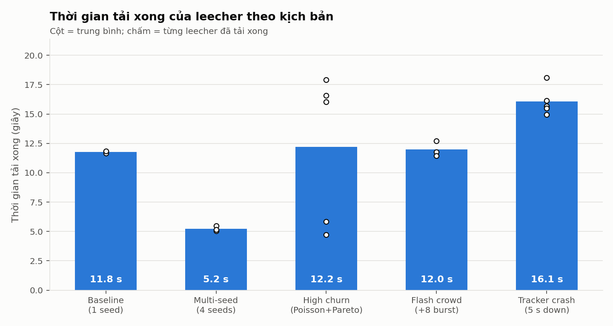
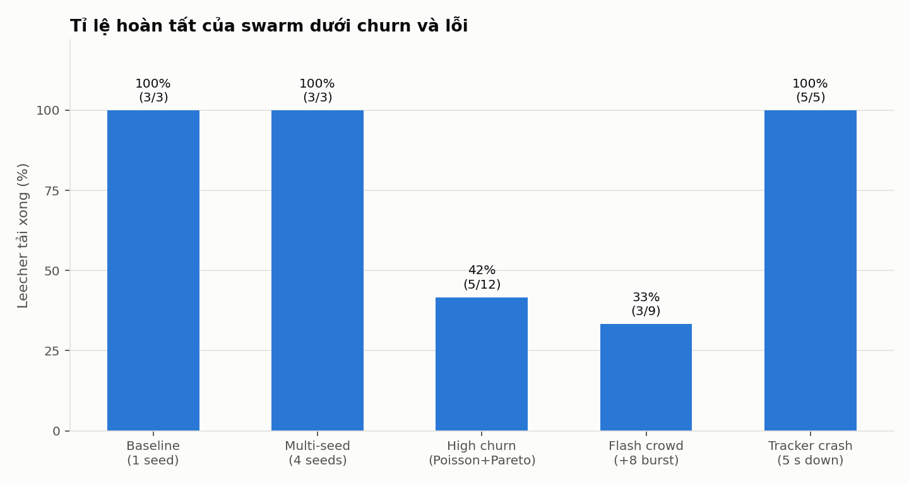
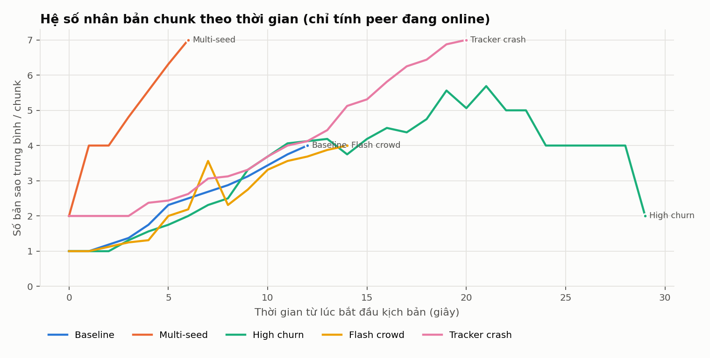
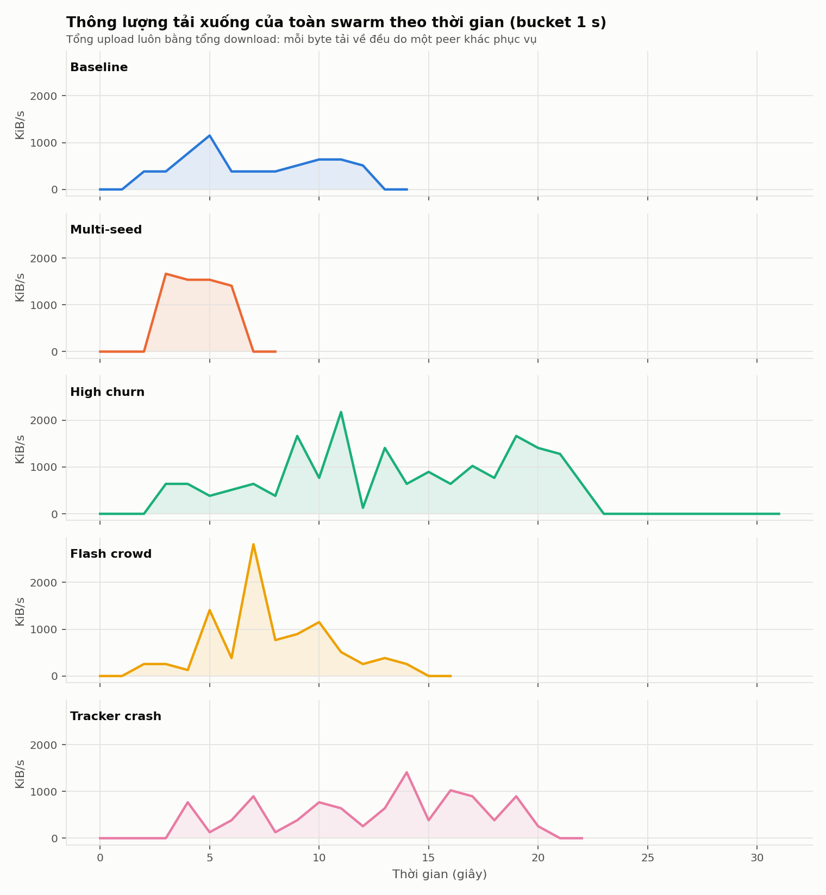
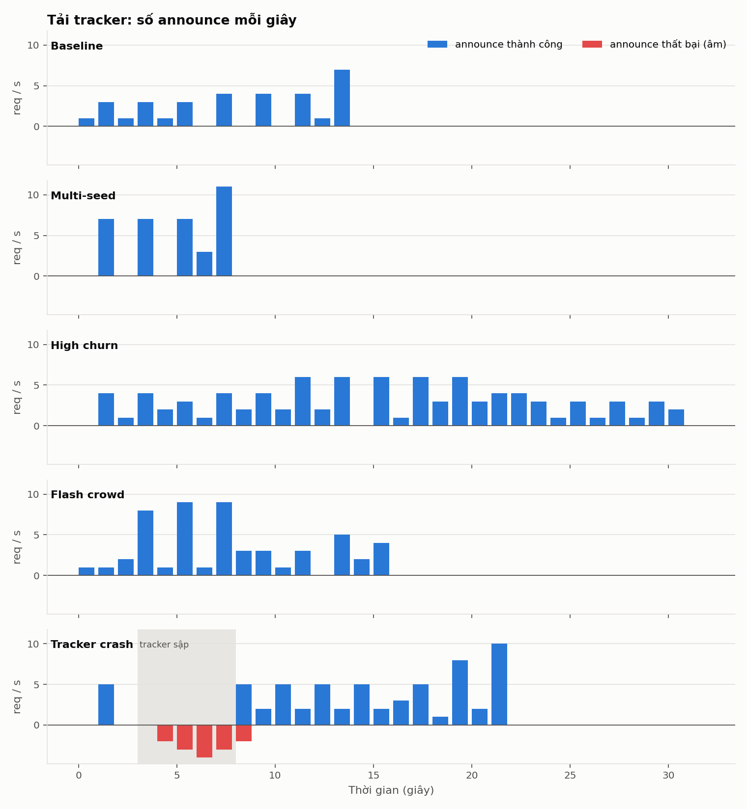
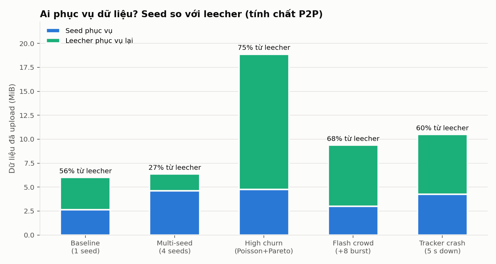

# Báo cáo thực nghiệm và đánh giá hiệu năng (C6)

_Sinh tự động bởi `py src/sim/run_experiments.py` lúc 2026-11-22 17:00:47. Peer: `-m peer` · Tracker: `-m src.tracker` · Máy chạy: Windows 11 · Python 3.14.2._

## 1. Phương pháp

- Mỗi kịch bản trong `scenarios/*.yaml` được chạy bằng launcher (C1): tracker và mọi peer là **tiến trình hệ điều hành riêng**, giao tiếp qua TCP/HTTP thật trên `127.0.0.1`. Dữ liệu là file 2 MiB sinh tất định, chia thành 16 chunk 128 KiB; mỗi chunk được kiểm SHA-1 khi nhận, file ghép xong được so SHA-256 với file gốc.
- Băng thông upload mỗi peer bị giới hạn bằng `--max-up-kbps` (KiB/s, Hợp đồng 4); độ trễ thêm ở tầng ứng dụng bằng `--latency-ms` (peer của B và StubPeer).
- Churn (C2) sinh từ `random_seed=42`: cùng seed cho cùng dãy sự kiện vào/ra/sập (dấu vân tay lịch churn ghi trong sự kiện `scenario_start`).
- Số liệu (C4) tính từ `logs/<kịch bản>/events.jsonl`; CSV trong `results/`, biểu đồ trong `results/charts/`. Đơn vị `kbps` = KiB/s.
- Mỗi kịch bản chạy **một lần**; thời gian tải có thể dao động vài trăm ms giữa các lần chạy. Thời gian tải trung bình chỉ tính leecher đã tải xong (leecher rời đi trước khi xong được tính trong tỉ lệ hoàn tất).

## 2. Bảng tổng hợp

| Kịch bản | Seed | Leecher | Hoàn tất | Thời gian tải TB (min–max) | Nhân bản TB | Leecher upload | Announce (TB/s) | peer_lost / switch / invalid |
|---|---:|---:|---:|---|---:|---:|---:|---|
| Baseline | 1 | 3 | 100% (3/3) | 11.8 s (11.7–11.8) | 2.38 | 56% | 32 (2.32) | 0 / 0 / 0 |
| Multi-seed | 4 | 3 | 100% (3/3) | 5.2 s (5.0–5.5) | 4.81 | 27% | 35 (4.54) | 0 / 0 / 0 |
| High churn | 1 | 12 | 42% (5/12) | 12.2 s (4.7–17.9) | 3.46 | 75% | 91 (3.03) | 27 / 13 / 0 |
| Flash crowd | 1 | 9 | 33% (3/9) | 12.0 s (11.4–12.7) | 2.46 | 68% | 53 (3.46) | 32 / 6 / 0 |
| Tracker crash | 2 | 5 | 100% (5/5) | 16.1 s (15.0–18.1) | 4.00 | 60% | 62 (2.90) | 0 / 0 / 0 |

## 3. Phân tích từng kịch bản

### 3.1 Baseline – 1 seed, 3 leecher
- **Kết quả:** 3/3 leecher tải xong, thời gian trung bình **11.77 s**; leecher tự phục vụ lại **56%** tổng dữ liệu upload; thông lượng đỉnh 1152 KiB/s.
- **Kết luận:** dù chỉ có một seed giới hạn 256 KiB/s, các leecher trao đổi chunk cho nhau ngay khi có, nên tổng băng thông phục vụ của swarm lớn hơn băng thông của seed – đúng tính chất P2P. Mọi file tải về khớp SHA-256 với file gốc.

### 3.2 Multi-seed – 4 seed, 3 leecher
- **Kết quả:** thời gian tải trung bình **5.23 s** so với 11.77 s ở baseline → **nhanh hơn 2.25×**; tỉ lệ dữ liệu do leecher phục vụ giảm còn 27%.
- **Kết luận:** thêm nguồn làm tăng tổng băng thông upload khả dụng; bộ tải song song (tối đa 4 chunk đồng thời, ≤ 2 yêu cầu/nguồn) trải yêu cầu lên nhiều seed nên rút ngắn thời gian tải. Mức tăng tốc nhỏ hơn 4× vì leecher ở baseline đã bù một phần băng thông và độ trễ cố định cho mỗi chunk không giảm theo số seed.

### 3.3 High churn – Poisson + Pareto + crash
- **Kết quả:** 12 leecher tham gia: 2 leecher tĩnh (2/2 tải xong) và 10 leecher động (3/10 tải xong trước khi rời; 4 bị kill đột ngột, 6 rời đàng hoàng). Tỉ lệ hoàn tất chung **42%**. Ghi nhận **27** lần `peer_lost` và **13** lần `switch_source`; hệ số nhân bản thấp nhất quan sát được = 1.
- **Kết luận:** leecher bị kill giữa lúc đang phục vụ làm đứt kết nối của peer khác; các peer phát hiện (`peer_lost`) và chuyển chunk sang nguồn khác (`switch_source`) nên các leecher tĩnh vẫn tải xong đúng hash. Thời gian sống Pareto (α = 1.8, trung bình 8 s) có giá trị nhỏ nhất x_m = 3.56 s, trung vị ≈ 5.2 s và phương sai vô hạn (α ≤ 2): đa số peer chỉ sống 3.6–5.2 s, ngắn hơn thời gian cần để tải đủ file, trong khi vài peer sống rất lâu. Peer động đến theo Poisson λ = 0.7/s nhưng bị giới hạn ở 10 peer (`max_dynamic_peers`). Seed gốc luôn online nên mọi chunk luôn có ít nhất 1 bản sao. Thời gian tải trung bình của kịch bản này không so trực tiếp với baseline được vì chỉ tính các peer đã tải xong (survivor bias).

### 3.4 Flash crowd – 8 leecher ập vào cùng lúc, rồi rời đồng loạt
- **Kết quả:** tỉ lệ hoàn tất **33%** (3/9), thời gian tải trung bình **11.97 s** (dài nhất 12.7 s); leecher phục vụ **68%** dữ liệu; tải tracker đỉnh 9 announce/giây.
- **Kết luận:** khi cả đám đông cùng đến, một seed không đủ băng thông; swarm vẫn chịu được vì chunk vừa tải xong lập tức được phục vụ lại (rarest-first giúp các leecher giữ những chunk khác nhau). Đợt rời đồng loạt bắt đầu ở 8.1 s, khi swarm còn đang tải: 6 leecher rời đi, trong đó 6 chưa tải xong. Hệ số nhân bản sụt xuống ngay sau đó (biểu đồ exp3); nhờ seed gốc vẫn online nên không chunk nào biến mất và các leecher còn lại vẫn tải xong.

### 3.5 Tracker crash – tracker bị kill ở giây 3, sống lại ở giây 8
- **Kết quả:** tiến trình tracker bị kill và ngừng 5.4 s; có **14** announce thất bại trong thời gian sập; announce thành công đầu tiên đến **0.23 s** sau khi tracker khởi động lại. Trong lúc tracker sập vẫn có **2176 KiB** được tải xong giữa các peer. 2/2 leecher đến trong lúc tracker sập vẫn tải xong. Tỉ lệ hoàn tất **100%** (5/5).
- **Kết luận:** tracker chỉ dùng để tìm peer, không nằm trên đường dữ liệu; các peer đã biết nhau tiếp tục trao đổi chunk trực tiếp khi tracker sập. Leecher mới đến trong lúc tracker sập không tìm được nguồn cho tới khi tracker sống lại (announce thử lại với back-off), sau đó tracker dựng lại swarm từ các announce định kỳ vì nó chỉ giữ trạng thái mềm (soft state) trong bộ nhớ. Các bucket 0 KiB/s trên biểu đồ thông lượng là do số liệu được ghi khi cả chunk 128 KiB hoàn tất, không phải do tracker.

## 4. Biểu đồ khác

## 5. Kết luận chung và hạn chế

- Hệ thống giữ **tính đúng** trong mọi kịch bản: mọi leecher báo `completed` đều có file trùng SHA-256 với file gốc; chunk sai hash bị từ chối.
- **Hiệu năng** tăng theo số nguồn (multi-seed) và nhờ leecher phục vụ lại (baseline, flash crowd).
- **Chịu lỗi:** mất nguồn → `peer_lost` → `switch_source`; tracker sập không làm gián đoạn trao đổi chunk giữa các peer đã biết nhau.
- **Hạn chế:** chạy trên một máy (loopback) nên độ trễ/băng thông là mô phỏng ở tầng ứng dụng (không có `tc netem` trên Windows); giới hạn băng thông là của phía upload; mỗi kịch bản chạy một lần nên chưa có khoảng tin cậy; kết quả có dao động nhỏ giữa các lần chạy do lập lịch luồng của hệ điều hành (lịch churn thì tất định); tải tracker được đo phía peer (`announce_ok`/`announce_failed`), số request phía server chỉ có khi tracker ghi log request.
