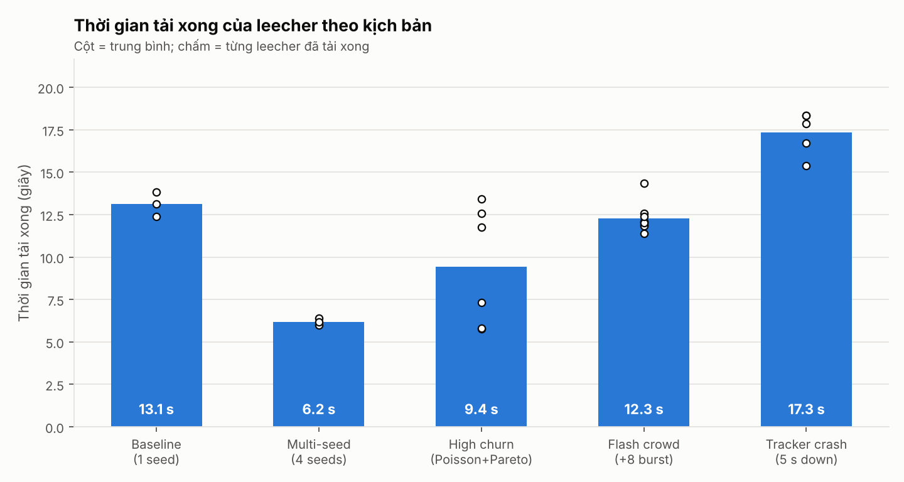
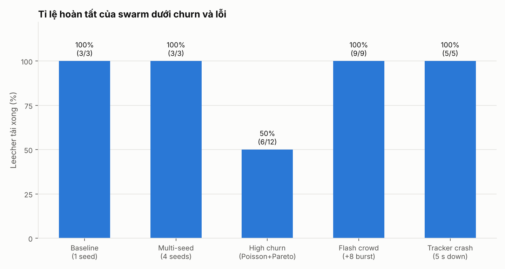
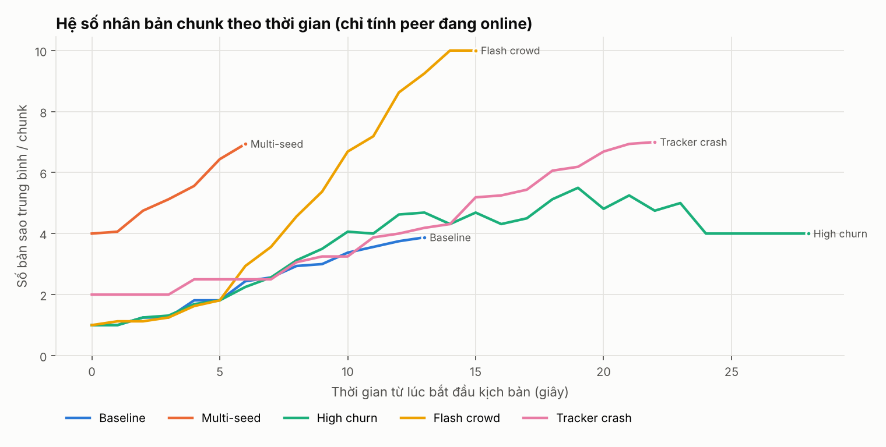
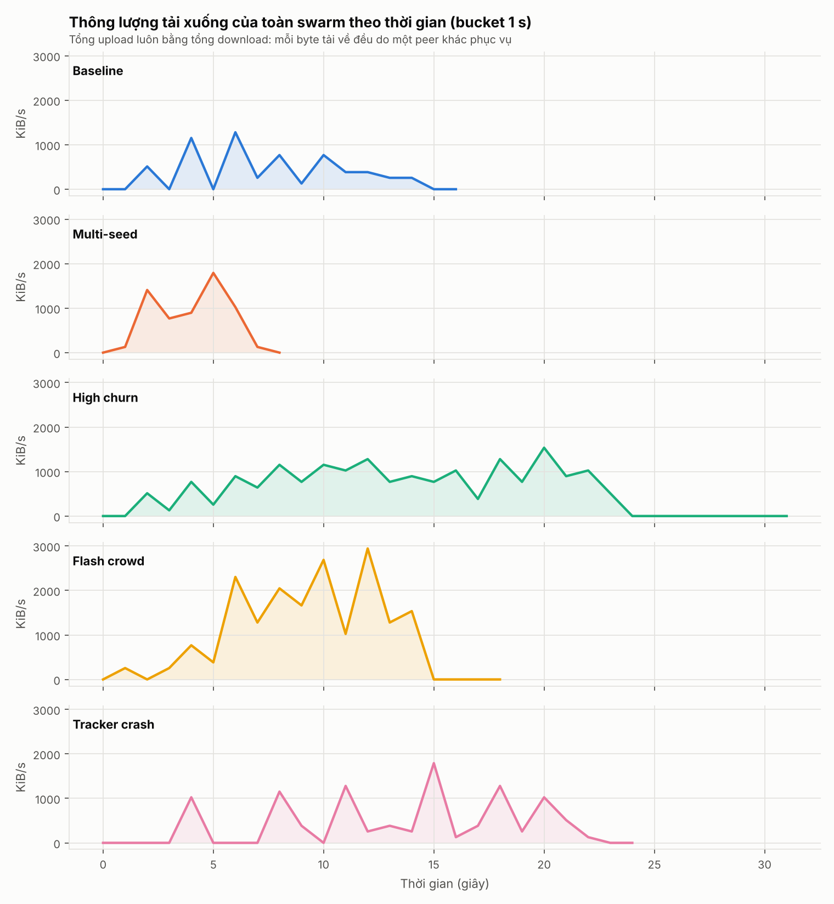
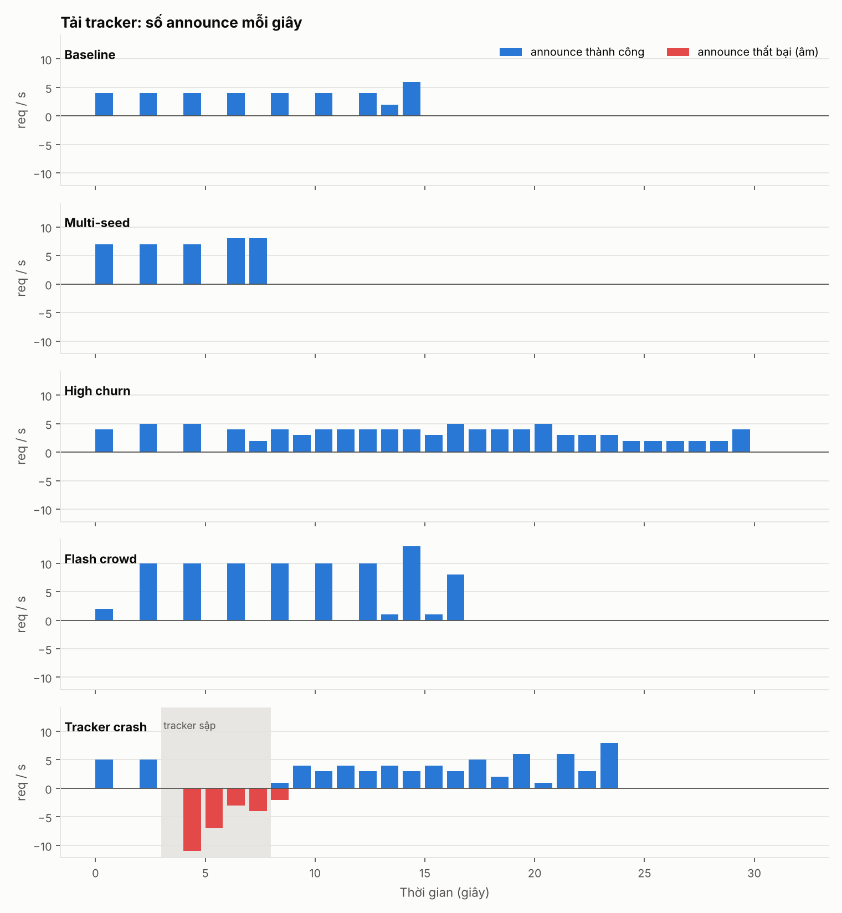
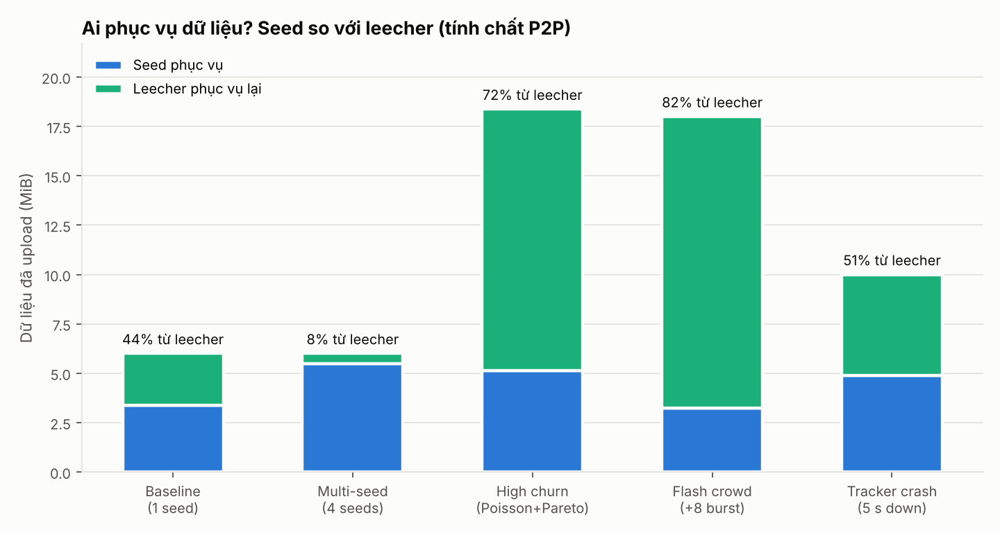

# Báo cáo thực nghiệm và đánh giá hiệu năng (C6)

_Sinh tự động bởi `py src/sim/run_experiments.py` lúc 2026-11-05 07:37:59. Peer: `src/sim/stub_peer.py` · Tracker: `src/sim/stub_tracker.py`._

## 1. Phương pháp

- Mỗi kịch bản trong `scenarios/*.yaml` được chạy bằng launcher (C1): tracker và mọi peer là **tiến trình hệ điều hành riêng**, giao tiếp qua TCP/HTTP thật trên `127.0.0.1`. Dữ liệu là file 2 MiB sinh tất định, chia thành 16 chunk 128 KiB; mỗi chunk được kiểm SHA-1 khi nhận, file ghép xong được so SHA-256 với file gốc.
- Băng thông upload mỗi peer bị giới hạn bằng `--max-up-kbps` (KiB/s, Hợp đồng 4); độ trễ thêm bằng `--latency-ms` (chỉ StubPeer).
- Churn (C2) sinh từ `random_seed=42`: cùng seed cho cùng dãy sự kiện vào/ra/sập (dấu vân tay lịch churn ghi trong sự kiện `scenario_start`).
- Số liệu (C4) tính từ `logs/<kịch bản>/events.jsonl`; CSV trong `results/`, biểu đồ trong `results/charts/`. Đơn vị `kbps` = KiB/s.
- **Lưu ý:** kết quả này đo bằng StubPeer/StubTracker của C. Khi peer thật của B và tracker thật của A sẵn sàng, chạy lại `py src/sim/run_experiments.py --peer-script "-m peer" --tracker-script "-m tracker"` để có số liệu cuối cùng.

## 2. Bảng tổng hợp

| Kịch bản | Seed | Leecher | Hoàn tất | Thời gian tải TB (min–max) | Nhân bản TB | Leecher upload | Announce (TB/s) | peer_lost / switch / invalid |
|---|---:|---:|---:|---|---:|---:|---:|---|
| Baseline | 1 | 3 | 100% (3/3) | 13.1 s (12.4–13.8) | 2.40 | 44% | 36 (2.37) | 0 / 0 / 0 |
| Multi-seed | 4 | 3 | 100% (3/3) | 6.2 s (6.0–6.4) | 5.27 | 8% | 37 (4.68) | 0 / 0 / 0 |
| High churn | 1 | 12 | 50% (6/12) | 9.4 s (5.8–13.4) | 3.62 | 72% | 95 (3.15) | 20 / 8 / 0 |
| Flash crowd | 1 | 9 | 100% (9/9) | 12.3 s (11.4–14.3) | 4.76 | 82% | 85 (4.95) | 0 / 0 / 0 |
| Tracker crash | 2 | 5 | 100% (5/5) | 17.3 s (15.4–18.4) | 4.03 | 51% | 70 (2.99) | 0 / 0 / 0 |

## 3. Phân tích từng kịch bản

### 3.1 Baseline – 1 seed, 3 leecher
- **Kết quả:** 3/3 leecher tải xong, thời gian trung bình **13.13 s**; leecher tự phục vụ lại **44%** tổng dữ liệu upload; thông lượng đỉnh 1280 KiB/s.
- **Kết luận:** dù chỉ có một seed giới hạn 256 KiB/s, các leecher trao đổi chunk cho nhau ngay khi có, nên tổng băng thông phục vụ của swarm lớn hơn băng thông của seed – đúng tính chất P2P. Mọi file tải về khớp SHA-256 với file gốc.

### 3.2 Multi-seed – 4 seed, 3 leecher
- **Kết quả:** thời gian tải trung bình **6.19 s** so với 13.13 s ở baseline → **nhanh hơn 2.12×**; tỉ lệ dữ liệu do leecher phục vụ giảm còn 8%.
- **Kết luận:** thêm nguồn làm tăng tổng băng thông upload khả dụng; bộ tải song song (tối đa 4 chunk đồng thời, ≤ 2 yêu cầu/nguồn) trải yêu cầu lên nhiều seed nên rút ngắn thời gian tải. Mức tăng tốc nhỏ hơn 4× vì leecher ở baseline đã bù một phần băng thông và độ trễ cố định cho mỗi chunk không giảm theo số seed.

### 3.3 High churn – Poisson + Pareto + crash
- **Kết quả:** 12 leecher tham gia (9 leecher động, 4 bị kill đột ngột). Tỉ lệ hoàn tất **50%** (4/9 leecher động tải xong trước khi rời). Ghi nhận **20** lần `peer_lost` và **8** lần `switch_source`; hệ số nhân bản thấp nhất quan sát được = 1.
- **Kết luận:** leecher bị kill giữa lúc đang phục vụ làm đứt kết nối của peer khác; các peer phát hiện (`peer_lost`) và chuyển chunk sang nguồn khác (`switch_source`) nên các leecher tĩnh vẫn tải xong đúng hash. Peer có thời gian sống ngắn (đuôi nặng của Pareto: nhiều peer sống rất ngắn) không kịp tải đủ – đây là nguyên nhân chính làm tỉ lệ hoàn tất < 100%. Do seed gốc luôn online nên mọi chunk luôn có ít nhất 1 bản sao.

### 3.4 Flash crowd – 8 leecher ập vào cùng lúc, rồi rời đồng loạt
- **Kết quả:** tỉ lệ hoàn tất **100%**, thời gian tải trung bình **12.29 s** (dài nhất 14.3 s); leecher phục vụ **82%** dữ liệu; tải tracker đỉnh 13 announce/giây.
- **Kết luận:** khi cả đám đông cùng đến, một seed không đủ băng thông; swarm vẫn chịu được vì chunk vừa tải xong lập tức được phục vụ lại (rarest-first giúp các leecher giữ những chunk khác nhau). Hệ số nhân bản tăng nhanh sau đợt ập vào và sụt mạnh khi rời đồng loạt (biểu đồ exp3); seed gốc là điều kiện để chunk không biến mất.

### 3.5 Tracker crash – tracker bị kill ở giây 3, sống lại ở giây 8
- **Kết quả:** tracker ngừng 5.1 s; có **27** announce thất bại trong thời gian sập; swarm đăng ký lại sau **1.51 s** kể từ khi tracker khởi động lại. Tỉ lệ hoàn tất **100%** (5/5).
- **Kết luận:** tracker chỉ dùng để tìm peer; các peer đã biết nhau tiếp tục trao đổi chunk trực tiếp khi tracker sập. Leecher mới đến trong lúc tracker sập không tìm được nguồn cho tới khi tracker sống lại (announce thử lại với back-off), sau đó tracker dựng lại swarm hoàn toàn từ các announce định kỳ mà không cần lưu trạng thái.

## 4. Biểu đồ khác

## 5. Kết luận chung và hạn chế

- Hệ thống giữ **tính đúng** trong mọi kịch bản: mọi leecher báo `completed` đều có file trùng SHA-256 với file gốc; chunk sai hash bị từ chối.
- **Hiệu năng** tăng theo số nguồn (multi-seed) và nhờ leecher phục vụ lại (baseline, flash crowd).
- **Chịu lỗi:** mất nguồn → `peer_lost` → `switch_source`; tracker sập không làm gián đoạn trao đổi chunk giữa các peer đã biết nhau.
- **Hạn chế:** chạy trên một máy (loopback) nên độ trễ/băng thông là mô phỏng; giới hạn băng thông là của phía upload; kết quả có dao động nhỏ giữa các lần chạy do lập lịch luồng của hệ điều hành (lịch churn thì tất định).
